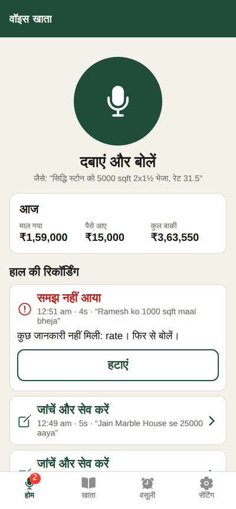
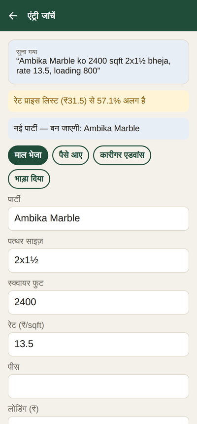
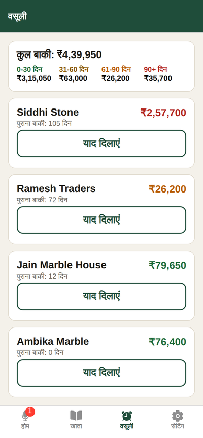
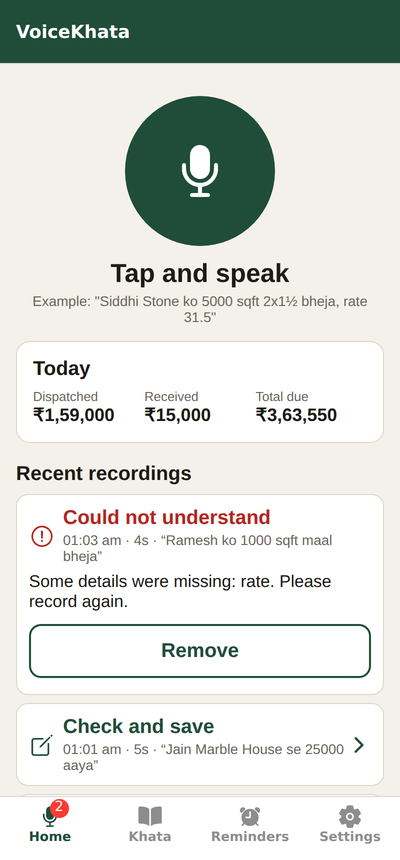
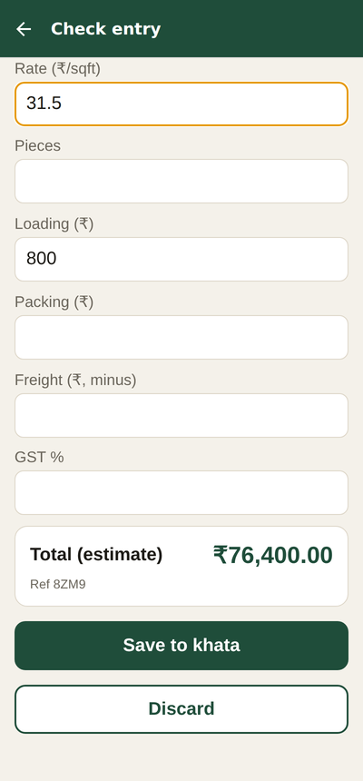
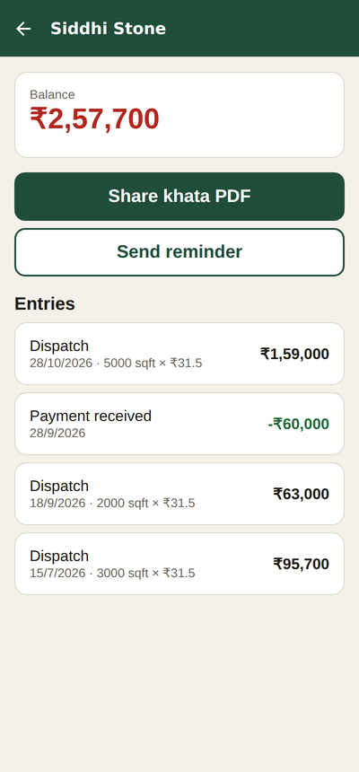
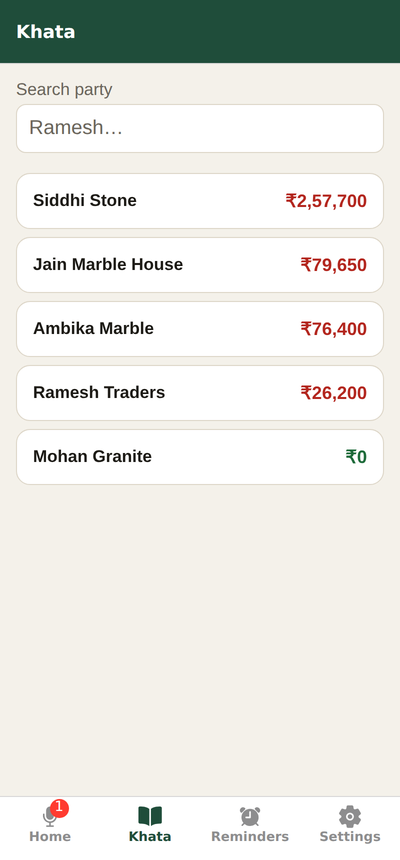

# VoiceKhata App

A voice-first khata (ledger) app for small traders. You speak an entry in Hindi or Hinglish, check what the app understood, and save it.

I built it for my father's stone trading business in Kota. He deals with customers, workers and transporters all day and doesn't want to type. He speaks, checks the numbers, and taps Save.

The repo has two parts:

```
mobile/   Android app (React Native, Expo, TypeScript)
server/   API + background jobs (Node.js, Express, BullMQ, PostgreSQL)
```

## Screenshots

Hindi by default, English in Settings.

| Home | Check entry | Reminders |
| --- | --- | --- |
|  |  |  |

| Home | Check entry (after fixing the rate) | Party khata | Khata |
| --- | --- | --- | --- |
|  |  |  |  |

## Features

- **Voice entries.** Tap the mic and say *"Siddhi Stone ko 5000 sqft 2x1½ bheja, rate 31.5"*. The server transcribes it (Groq Whisper) and turns it into an entry (Gemini).
- **Check before saving.** The app shows what it heard and lets you fix any field, with the total updating as you edit. It warns when the rate is far from the price list (13.5 heard instead of 31.5 is a typical mistake) and when a party name is new.
- **Works without internet.** Recordings are saved on the phone and uploaded on their own when the network is back.
- **Khata.** Every party's balance and history, and the khata PDF shared on WhatsApp from the owner's own number. The last downloaded copy is shown when offline.
- **Payment reminders.** Who owes money and for how long (0–30, 31–60, 61–90, 90+ days), and a one-tap WhatsApp reminder with a UPI payment link.
- **Notifications.** When an entry is ready to check, and a weekly summary of overdue payments.

## How it works

```
Phone: record → saved locally (SQLite + file)
          │ when online
          ▼
POST /api/app/voice   (X-Client-Entry-Id: UUID made on the phone)
          ▼
Server: BullMQ queue → Whisper → Gemini → validation → pending entry
          ▼
Phone: "Check and save" → POST /api/app/entries/:id/save
          ▼
Server: re-validate, recalculate in paise, apply to balances (one DB transaction, row lock)
```

Some decisions:

- **No duplicate entries on retry.** Each recording gets a UUID on the phone. If the network drops after the server saved an upload, the retry carries the same UUID and gets the existing upload back. The queue job id and a unique index on the entry's source add two more checks.
- **The server never trusts the phone or the AI.** The AI's JSON is validated with Zod (missing fields, negative or absurd amounts are rejected). Edited values are validated again, and the bill is calculated on the server in integer paise.
- **Slow work in a queue.** Transcription and the AI call take a few seconds and hit rate limits, so they run in a BullMQ worker: 5 attempts with exponential backoff, at most 12 jobs a minute, one at a time so entries keep their order.
- **Measured accuracy.** Every saved entry stores what the AI understood and what was finally saved. `npm run accuracy` in `server/` shows how often each field was right.
- **Ageing report.** Payments settle the oldest bills first, so the unpaid amount is matched to the newest dispatches to find how long it has been due.

## Tech

- **Mobile:** React Native (Expo), TypeScript, Expo Router, expo-audio, expo-sqlite, expo-file-system, expo-notifications, TanStack Query. Tests: Jest, React Native Testing Library.
- **Server:** Node.js, Express, TypeScript, BullMQ + Redis, PostgreSQL (pg_trgm for fuzzy name matching), PDFKit, Zod, JWT + bcrypt. Tests: Vitest, Supertest, fast-check (property-based tests of the ledger) against a real PostgreSQL and Redis.
- **CI:** GitHub Actions runs both test suites on every push.

## Running locally

**Server** (needs Node.js 22 and Docker):

```bash
docker compose up -d                 # PostgreSQL + Redis
cd server
cp .env.example .env                 # add JWT_SECRET, GEMINI_API_KEY, GROQ_API_KEY
npm install
npm run migrate
npm run seed:prices
npm run setup -- "Shah Stone Traders" +91XXXXXXXXXX "Papa" 4821
npm run dev
```

**App:**

```bash
cd mobile
npm install
cp .env.example .env.local           # EXPO_PUBLIC_API_URL=http://<your laptop IP>:3000
npm run web                          # quick preview in the browser
```

Voice recording and SQLite need a build on a real phone (not Expo Go):

```bash
npx eas-cli@latest build --profile development --platform android   # for development
npx eas-cli@latest build --profile preview --platform android       # installable APK
```

## Tests

```bash
cd server && npm test     # ledger, API, queue, validation, money, property-based tests
cd mobile && npm test     # sync engine, review form, money, reminders, API client
```

## Deploying

- **Server:** Render (`render.yaml` in this repo), with PostgreSQL on Supabase and Redis on Upstash.
- **App:** an APK built with EAS Build, installed directly on the phone.
